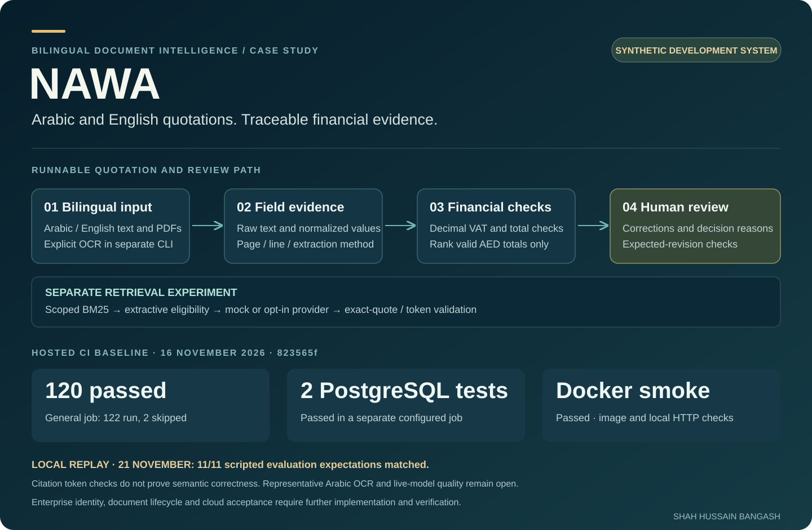
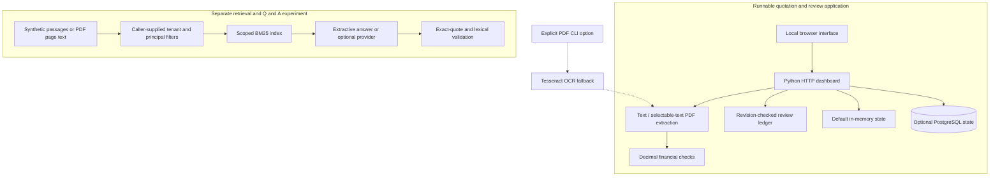
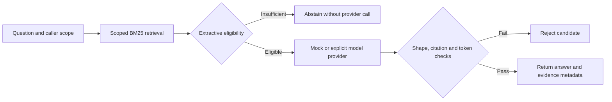
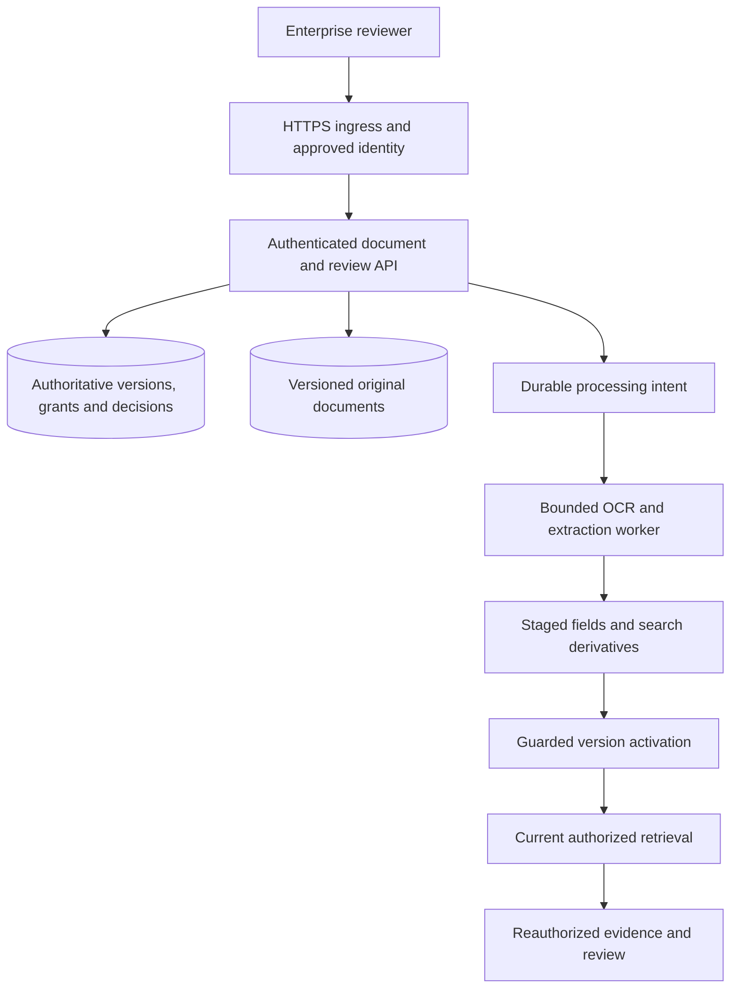

# NAWA Case Study

## Engineering Arabic and English quotation intelligence with traceable evidence

**Enterprise solution architecture · Bilingual document AI · Retrieval and generation · Human review · Security and governance · Cloud design · Evaluation research**

| Project | At a glance |
|---|---|
| Project owner | Shah Hussain Bangash · [GitHub](https://github.com/zenithdevelopers7-source) |
| Business domain | Arabic and English supplier quotation review |
| Engineering role | Sole developer, as described in the project README |
| Source baseline | [`823565f`, 16 November 2026][baseline] |
| Runnable application | Python local dashboard, deterministic extraction, financial validation and review; optional PostgreSQL persistence |
| Retrieval experiment | Scoped BM25, extractive answers, mock-first generation contract and exact-quote validation |
| Hosted verification | General job: 122 tests run, 120 passed and 2 skipped; separate PostgreSQL job: 2 passed; Docker smoke: passed |
| Evidence scope | Synthetic fixtures and a single-user development application; enterprise identity, representative bilingual benchmarks and current cloud acceptance remain further work |

**The architectural contribution:** NAWA makes quotation values inspectable through source evidence, normalizes Arabic and English numeric inputs, separates arithmetic from generated language, and records review decisions against an expected revision. Its broader design explains how document lifecycle, permissions and asynchronous processing would support an enterprise deployment.

[Business problem](#1-business-problem-and-objectives) · [Architecture](#3-architecture-and-implementation-boundaries) · [Bilingual extraction](#4-bilingual-document-processing) · [AI and retrieval](#6-retrieval-generation-and-agentic-boundaries) · [Evidence](#9-engineering-results-and-reproducibility) · [Research](#10-evaluation-research-and-next-experiments)

## 1. Business problem and objectives

Procurement reviewers compare supplier names, currencies, subtotals, VAT and totals across documents with different languages and layouts. A scanned page introduces recognition errors; Arabic numerals and bidirectional text introduce normalization and reading-order problems. A correct-looking total can still be unsupported or inconsistent with the other fields.

NAWA addresses the path from document to reviewed comparison. Its current comparison is price-only and AED-only. Supplier suitability, technical compliance, delivery terms, award authority and purchase execution belong to a broader procurement process.

| Objective | Current engineering response | Future business measure |
|---|---|---|
| Reduce repeated evidence lookup | Extracted field includes its source line; PDF path adds page and extraction method | Time to verify a sampled critical field |
| Make bilingual numeric processing consistent | Recognized Arabic/English labels and digit/separator normalization | Field exact match by language, layout and scan type |
| Detect arithmetic discrepancies | Decimal calculations for VAT and totals | Missed discrepancies, false flags and correction effort |
| Make review changes inspectable | Correction reasons, expected revisions and replayed review history | Review duration, disagreement and stale-update rejection |
| Keep answers tied to available evidence | Scoped lexical retrieval, abstention and citation checks | Retrieval recall, supported-claim rate and correct abstention |

The business hypothesis is that connected evidence and exception checks can reduce review effort without weakening accountability. No measured staffing saving, procurement saving or productivity uplift is established by the current fixtures.

## 2. A worked bilingual quotation scenario

The repository includes three small synthetic text quotations. A local replay of the unchanged source on 21 November 2026 produced the following results; the [machine-readable evidence][replay] records inputs, checks, environment and source-file hashes.

| Synthetic quotation | Subtotal AED | Stated VAT AED | Total AED | Observed check |
|---|---:|---:|---:|---|
| Example English Supplies | 1,000.00 | 50.00 | 1,050.00 | VAT and total checks passed |
| شركة المثال للتوريدات | 900.00 | 45.00 | 945.00 | Arabic digits normalized; both checks passed |
| Example Incorrect VAT | 800.00 | 30.00 | 830.00 | VAT mismatch detected; component total itself is consistent |

At the fixture's stated 5% rate, the third quotation's expected VAT is AED 40.00. Its total equals its stated subtotal plus stated VAT, so checking only the final addition would miss the discrepancy. NAWA evaluates both conditions and excludes that quotation from the valid-price ranking.

The Arabic quotation has the lowest valid total in this fixture set. That is an observed numerical ranking, not a supplier-award decision. The local replay also confirmed that approval of the VAT-mismatch quotation is blocked, a valid quotation can reach `approved`, and a stale expected revision is rejected.

The quoted rate is a test input. The calculation code does not determine the legally applicable tax treatment.

## 3. Architecture and implementation boundaries

NAWA's current source has two connected demonstration paths: a quotation dashboard with review and optional persistence, and a separate retrieval/Q&A experiment. They share engineering ideas but are not one fully integrated authenticated enterprise RAG service.

*Implemented module responsibilities, not a cloud deployment diagram. The dashboard's PDF upload route uses text extraction; the separate PDF CLI explicitly enables OCR.*

### Where the engineering lives

| Component | Source responsibility |
|---|---|
| [`core.py`][core] | Known quotation labels, numeric normalization, required-field checks, arithmetic and ranking |
| [`pdf_ingest.py`][pdf-source] | Page-aware selectable text, optional OCR, limited Arabic layout normalization and evidence metadata |
| [`dashboard.py`][dashboard] | Local HTTP endpoints, sample intake, bounded uploads, comparison and review interaction |
| [`retrieval.py`][retrieval] | Permission-filtered passage collection, tokenization and BM25 scoring |
| [`grounded_qa.py`][extractive] and [`rag.py`][rag] | Extractive answer, optional provider contract and candidate-answer validation |
| [`review.py`][review] | Replayable field corrections, decisions, arithmetic checks, revision checks and hash links |
| [`postgres_state.py`][postgres] | Optional database persistence, transactions and locked review updates |
| [`evaluation.py`][evaluation] | Eleven scripted status, citation and abstention scenarios |

The [system architecture specification][architecture] describes a larger target: authenticated API, asynchronous worker, object storage, authoritative document versions, scoped retrieval, current-grant checks and procurement exports. Those are target responsibilities, not proof that the current dashboard implements them.

## 4. Bilingual document processing

### Normalize values while retaining evidence

The text extractor recognizes a fixed set of English and Arabic labels, requires the supported fields and rejects duplicates. It converts Arabic-Indic and Eastern Arabic digits to ASCII, handles supported decimal/thousands separators, and parses finite nonnegative values using `Decimal`.

For example, `٩٤٥٫٠٠` becomes `945.00`. Source text and line numbers remain available so a reviewer can inspect the original representation. The implementation supports AED quotations; general currency interpretation, unstructured tables and arbitrary supplier layouts need further work.

### Distinguish selectable text from OCR

The PDF module first uses PyMuPDF's text layer. When explicitly enabled, Tesseract handles pages without selectable text after checking that the requested language data is installed. Evidence records the page, extracted line, raw extracted text and whether the method was text extraction or OCR.

That distinction matters: successful extraction from a digital Arabic PDF is not evidence of scanned Arabic OCR accuracy. The committed scanned OCR regression is English. Installing Arabic language data in CI does not establish Arabic scanned-document quality.

### Treat Arabic layout repair as a bounded heuristic

The PDF normalizer applies Unicode NFKC and attempts a limited word/numeral reordering only when the result produces a recognized field label. It is useful for particular synthetic visual-order artifacts, not a general solution to Arabic shaping, bidirectional layout or table reconstruction.

The current evidence precision is **page and extracted line**. Bounding-box citations, a durable original-file archive and exact visual highlighting are not implemented by this path. Some image-only pages can be skipped when OCR is disabled; a production completeness check would need to distinguish a harmless blank page from a missing scanned attachment.

Tesseract's [official quality guidance][tesseract] identifies resolution, skew, image processing and page segmentation as quality factors. NAWA's fixed 2× rendering and segmentation choice should therefore be evaluated across representative layouts rather than assumed optimal for Arabic scans.

## 5. Deterministic comparison and human review

### Keep financial checks outside the language model

The implemented checks are:

`expected VAT = round_half_up(subtotal × stated VAT rate / 100, 2 decimal places)`

`expected total = round_half_up(subtotal + stated VAT amount, 2 decimal places)`

The comparator ranks only quotations passing both checks, ordered by total and a deterministic supplier-name tie-break. These rules make a useful distinction between values printed on a document and values calculated from them.

Arithmetic consistency does not prove that OCR read the correct number, that a quotation includes every charge, or that the stated rate is appropriate. A reviewer must still resolve source ambiguity and commercial scope.

### Replay corrections rather than overwrite extraction

The review module starts with the extracted fields and evidence. Subsequent events record corrections or `approve`, `reject` and `request_changes` decisions, with actor labels, reasons and expected revisions. Approval is blocked while the financial checks fail. Final approved/rejected review records cannot be edited through the normal transition functions.

Hash-linked events detect some accidental edits. They are not tamper-proof: a person with write access can recompute the chain. Actor labels are self-asserted, correction quote/line assertions are not verified against original document bytes, and separate-person approval is not enforced. Those are concrete enterprise integration requirements.

### Separate in-memory, JSON and database behavior

The CLI's JSON ledger does not provide multi-process locking. The dashboard defaults to ephemeral in-memory records. Optional PostgreSQL storage persists quotations and review ledgers, applies checksum-checked migrations, and locks a review row while checking its revision and updating the ledger.

This gives the database mode a real concurrency boundary, while authentication and decision authority remain unresolved. The stored JSON includes extraction evidence; original uploaded bytes are not retained. Re-uploading the same input creates another quotation record because content deduplication is not implemented.

## 6. Retrieval, generation and agentic boundaries

### Filter before building retrieval statistics

`BM25Index` accepts an explicit tenant and principal and selects permitted passages before computing frequencies and scores. Restricted text therefore does not influence that index's corpus statistics. Passage metadata retains document ID, version, page, source and extraction method.

The caller supplies those identities, so this demonstrates scoped retrieval logic—not authenticated multi-tenant access. A trusted identity-to-grant resolution service is required before exposing it to real users. The index also does not provide a complete current-grant revocation or document-publication lifecycle.

### Retain an inspectable lexical baseline

The runnable retrieval module implements BM25, not semantic embeddings or hybrid fusion. The [architecture decisions][adrs] propose comparing hybrid retrieval against that baseline on identical data and access scopes. This is a measured promotion decision to make later; no hybrid quality gain has been demonstrated in the inspected implementation.

The extractive path returns a verbatim passage or sentence when a lexical coverage condition is satisfied. Unsupported questions produce `insufficient_evidence`. The coverage threshold is a heuristic, not a calibrated probability that the answer is correct.

### Constrain generated candidates

The optional RAG path first applies extractive eligibility, then passes retrieved passages to a provider. The default mock returns existing excerpts without using a model or network. A separate opt-in OpenAI adapter requests structured JSON; live-provider behavior remains unverified.

The validator checks the answer shape, passage IDs, exact quoted substrings and whether answer content tokens occur within cited quotes. Citation page/version metadata is reconstructed from retrieved hits, rather than accepted from arbitrary model fields. A failed gate produces `rejected_ungrounded`.

### Reproduced limitation: supported tokens can express a false relationship

The source passage says **Subtotal AED 1000.00** and **Grand total AED 1050.00**. During the local replay, the candidate **“Subtotal AED 1050.00”** passed `validate_generated` when it cited that passage: every token appeared in the source, but the number was assigned to the wrong field.

The [evidence record][replay] retains this negative result. It demonstrates why exact quotes and token coverage are insufficient for semantic correctness. A next implementation should use typed field-to-value bindings for structured financial answers and assess remaining narrative claims separately. That improvement has not been implemented by this case-study update.

### Why an agent is not required for the current workflow

NAWA's current extraction, retrieval and review paths are fixed pipelines. No autonomous planner, LangGraph runtime, dynamic tool discovery or agent memory is established in this repository. Microsoft's [RAG design guide][azure-rag] distinguishes standard fixed retrieval from agents that decide when and how to retrieve.

A future bounded agent could assemble an exception brief from authorized quotations and request further evidence. Tool permissions, execution budgets, current access checks and explicit review would need to precede action. Purchase commitments and supplier awards should remain outside an exploratory document assistant's authority.

## 7. Enterprise security and governance design

| Concern | Implemented foundation | Enterprise control still required |
|---|---|---|
| Sensitive document access | Caller-scoped retrieval and negative synthetic fixtures | Authenticated tenant membership, authoritative grants and enforcement on every endpoint |
| Upload handling | Filename/type/size checks, local temporary files and restrictive response headers | Malware scanning, parser isolation, resource controls and comprehensive file validation |
| Stale or revoked evidence | Document/version metadata in retrieval and expected review revision | Reauthorization on citation open, cached-answer handling and lifecycle reconciliation |
| Decision integrity | Financial approval block and revision checks; locked PostgreSQL updates | Verified actors, role-based authority, separation of duties and accountable approvals |
| Audit integrity | Replayable hash-linked history | Protected audit storage, trustworthy timestamps, retention and independent oversight |
| External model exposure | Explicit provider opt-in and retrieved excerpts only | Approved data handling, provider assessment, budgets, telemetry and adversarial evaluation |
| Retention and recovery | Optional extracted-record persistence and documented isolated restore exercise | Original/derivative inventory, encryption, deletion policy and measured recovery objectives |

The [security design][security] specifies a broader control model for source access, revocation, logs and recovery. The local app's loopback binding reduces exposure but does not provide authenticated multiuser security. A container exposing a loopback port also remains different from an approved private cloud application.

For a UAE enterprise deployment, jurisdiction, permissible data processing, residency, provider terms and retention must be determined with the institution's data, security and legal owners. No compliance certification or data-residency approval is established by this case study.

## 8. Infrastructure, persistence and cloud architecture

### Demonstrated local delivery

The [Dockerfile and Compose configuration][docker] package a non-root Python application with localhost-only host publication. The smoke workflow runs it with a read-only filesystem, temporary scratch space, dropped capabilities and no-new-privileges, then verifies the homepage, sample endpoint and extracted English total.

Optional PostgreSQL 17 storage uses a separate Compose override and named volume. The application applies migrations transactionally, and `/api/ready` checks configured storage access. Readiness is not a backup or data-integrity verification.

The [Phase 11 guide][phase11] records a manual synthetic backup/restore and database outage/recovery exercise. That is historical local evidence; it does not establish automated encrypted backups or an AWS recovery time.

### Reported AWS context and target responsibilities

The [cloud operations document][cloud] describes a reported shared AWS development workspace with EC2 in Stockholm, containers, Caddy, PostgreSQL, Redis and Cognito/Google sign-in. It cites résumé-reported observations. The public synthetic dashboard does not reproduce that identity stack, and current cloud topology, configuration and workflow acceptance were not verified for this case study.

The target design should place authenticated application traffic behind controlled ingress, retain original documents in versioned object storage, use a durable worker for variable OCR workloads, and make authoritative metadata/grants distinct from derived search indexes. These are architectural requirements rather than deployed components in the current source.

*Target enterprise responsibility model. Asynchronous workers, object archives, publication controls and enterprise identity are not claimed as implemented by the synthetic dashboard.*

### Cost and reliability questions

Keep text extraction, OCR, retrieval, generation and human review timing separate. Compare cost per **reviewed quotation**, including failed parses, reprocessing and correction effort, rather than reporting only a model token price.

A cloud pilot needs image/configuration identifiers, capacity and failure-domain assumptions, a measured workload, provider usage, backup coverage and restoration evidence. No production availability, p95 latency, monthly cloud cost or RTO/RPO has been measured by the evidence presented here.

## 9. Engineering results and reproducibility

### Hosted evidence for the pinned application revision

The two hosted workflows for [`823565f`][baseline] completed successfully on 16 November 2026. Job logs were inspected directly.

| Job | Recorded result | What it establishes |
|---|---|---|
| General synthetic tests | 122 run; 2 skipped; 120 completed successfully | The configured unit/demo suite passed with PDF/OCR dependencies installed; PostgreSQL tests were skipped in this job |
| PostgreSQL integration | 2 tests passed | The separately configured PostgreSQL persistence tests completed |
| Docker smoke | Passed | Image built and container responded to the selected local HTTP checks, including total `1050.00` |

The PostgreSQL tests are the same two skipped in the general job. Do not add 122 and 2 and call the result 124 distinct tests. See the [test workflow run][ci-tests], [container workflow run][ci-docker], [test definitions][ci-config] and [PostgreSQL tests][pg-tests].

The database tests exercise persistent English/Arabic records and reviews, repeated migrations, expected-revision conflicts, concurrent decisions and application-process restart behavior. The Docker job's HTTP checks are smoke tests; they do not establish browser usability, accessibility, load capacity or production readiness.

### Additional local replay on 21 November 2026

| Check | Observed result |
|---|---|
| Three committed quotation fixtures | English and Arabic valid; incorrect VAT detected |
| Price-only comparison | Arabic quotation selected as lowest among numerically valid inputs |
| Review checks | Invalid approval blocked, valid approval recorded, stale revision blocked |
| Scripted RAG evaluation | 11/11 fixture expectations satisfied |
| Semantic counterexample | Incorrect subtotal relation accepted by lexical validation; limitation reproduced |

The [replay record][replay] and [reproduction script][reproduce] identify the pinned modules and fixtures. This was a selected standard-library replay on Windows, not a local rerun of PDF, OCR, PostgreSQL, Docker, browser or cloud checks. The eleven fixtures evaluate expected statuses, citation scope and abstention behavior; they are not an independent model-quality or adversarial-security benchmark.

## 10. Evaluation research and next experiments

The existing [bilingual evaluation plan][plan] proposes 60 documents: 20 Arabic, 20 English and 20 mixed-language, each language group balanced between scans and digital PDFs. It proposes 30 development and 30 holdout documents, keeping related layout templates in one split. These are planned dataset sizes, not published benchmark results.

The [evaluation report][report] is explicitly a pre-run edition. Its proposed 95% numeric-field and citation targets are not achieved scores or approved release criteria.

| Research question | Experiment | Measurements |
|---|---|---|
| Which Arabic layouts cause errors? | Compare text extraction and OCR on independently labeled layouts, with fixed normalization rules | Character error rate, field exact match, missing/spurious fields and page-order errors |
| Does hybrid retrieval justify its complexity? | Compare BM25 with a candidate hybrid method on the same authorized corpus and query set | Paired Recall@5, citation quality, abstention, p95 latency and cost |
| Can typed field bindings prevent relation errors? | Compare lexical validation with structured field/value checks on numeric swaps and omitted context | Invalid-claim acceptance and valid-claim rejection |
| Does evidence reduce review effort? | Assign matched quotation tasks with an agreed review rubric | Verification time, correction rate, review time and reviewer agreement |
| Do lifecycle changes preserve access boundaries? | Revoke, replace, delete and restore synthetic documents across warmed results and source links | Unauthorized disclosure count, stale evidence exposure and recovery time |

Predefine scoring, configuration and failure categories; use fluent bilingual labelers with adjudication; report denominators and uncertainty by language and format. A three-query retrieval fixture or eleven scripted scenarios cannot establish representative Arabic/English quality.

This approach supports applied research through controlled comparisons and negative results. It does not claim a novel OCR model, a trained document model or a completed scientific benchmark.

## 11. Architecture decisions and trade-offs

| Decision | Benefit | Cost or next verification |
|---|---|---|
| Prefer digital text; make OCR explicit | Repeatable, lower-complexity path for usable text PDFs | Completeness and quality vary by PDF; evaluate mixed text/image pages |
| Use fixed-label extraction and Decimal arithmetic | Inspectable values and predictable financial checks | Limited layout and currency coverage; requires explicit extension |
| Keep BM25 as runnable baseline | Transparent exact-term retrieval without model dependency | Paraphrase and cross-language retrieval need separate evaluation |
| Validate exact quotes and metadata | Rejects several simple invented or forged outputs | Does not validate field relationships or semantic entailment |
| Persist reviews as replayable events | Shows changes, reasons and revision history | Hash links and actor labels do not establish trustworthy audit or authority |
| Add optional PostgreSQL before broad service expansion | Demonstrates persistence and locked updates with a small deployment | Authentication, originals, deduplication and operating ownership remain open |
| Design asynchronous publication separately | Clarifies future retry and consistency boundaries | Durable worker and version activation need implementation and fault tests |

The [architecture decision document][adrs] gives the target rationale. The case study distinguishes those proposed contracts from the inspected executable behavior.

## 12. Technical demonstration and delivery gates

A ten-minute demonstration should make one traceable journey concrete:

1. **Frame the problem:** show an English and an Arabic synthetic quotation and identify the reviewer's task.
2. **Inspect evidence:** show raw text, normalized values and source-line references; use the PDF CLI separately to demonstrate page/method metadata.
3. **Explain arithmetic:** show why the AED 830 quotation fails VAT even though its component sum is consistent.
4. **Review an exception:** record a correction or request for changes, explain expected revisions, and demonstrate blocked invalid approval.
5. **Show retrieval separately:** ask an authorized lexical query, then an unsupported/restricted query; state that identities are simulated.
6. **Challenge the validator:** show the documented subtotal counterexample and explain the proposed field-binding improvement.
7. **Close with delivery evidence:** open the pinned CI jobs, identify the optional database mode and explain the next enterprise gate.

For a fresh synthetic local container demonstration, use the [Phase 10 guide][phase10]. For database mode, follow the separate Phase 11 setup rather than assuming a previous memory session migrates automatically.

| Gate | Completion evidence |
|---|---|
| Current reproducible demonstration | Exact revision, real synthetic UI screenshots and a recorded extraction-to-review journey |
| Representative bilingual benchmark | Frozen labels, layout-separated holdout, language/format slices and error analysis |
| Authenticated enterprise boundary | Verified identities, current grants, protected originals, role checks and negative end-to-end tests |
| Durable processing and lifecycle | Interrupted-job replay, idempotent writes, one active version and revoked-source denial |
| Approved cloud pilot | Recorded deployment, provider configuration, security review, workload cost and isolated restoration |

NAWA demonstrates the engineering connection between bilingual input handling, source evidence, financial validation and review. Its next development priorities follow directly from observed behavior: representative Arabic quality, stronger claim binding, trusted access control and verified document lifecycle operations.

---

**Evidence reviewed:** 21 November 2026. Application claims refer to the pinned source baseline and the explicitly scoped runs. Earlier architecture PDFs remain design/reference material; the historical résumé-reported 123-test observation is not substituted for the inspected CI results.

[baseline]: https://github.com/zenithdevelopers7-source/nawa-document-intelligence/commit/823565f7c44c15b07719b91670fe8bbfb8d96521
[core]: https://github.com/zenithdevelopers7-source/nawa-document-intelligence/blob/823565f7c44c15b07719b91670fe8bbfb8d96521/demo/nawa_demo/core.py
[pdf-source]: https://github.com/zenithdevelopers7-source/nawa-document-intelligence/blob/823565f7c44c15b07719b91670fe8bbfb8d96521/demo/nawa_demo/pdf_ingest.py
[dashboard]: https://github.com/zenithdevelopers7-source/nawa-document-intelligence/blob/823565f7c44c15b07719b91670fe8bbfb8d96521/demo/nawa_demo/dashboard.py
[retrieval]: https://github.com/zenithdevelopers7-source/nawa-document-intelligence/blob/823565f7c44c15b07719b91670fe8bbfb8d96521/demo/nawa_demo/retrieval.py
[extractive]: https://github.com/zenithdevelopers7-source/nawa-document-intelligence/blob/823565f7c44c15b07719b91670fe8bbfb8d96521/demo/nawa_demo/grounded_qa.py
[rag]: https://github.com/zenithdevelopers7-source/nawa-document-intelligence/blob/823565f7c44c15b07719b91670fe8bbfb8d96521/demo/nawa_demo/rag.py
[review]: https://github.com/zenithdevelopers7-source/nawa-document-intelligence/blob/823565f7c44c15b07719b91670fe8bbfb8d96521/demo/nawa_demo/review.py
[postgres]: https://github.com/zenithdevelopers7-source/nawa-document-intelligence/blob/823565f7c44c15b07719b91670fe8bbfb8d96521/demo/nawa_demo/postgres_state.py
[evaluation]: https://github.com/zenithdevelopers7-source/nawa-document-intelligence/blob/823565f7c44c15b07719b91670fe8bbfb8d96521/demo/nawa_demo/evaluation.py
[architecture]: https://github.com/zenithdevelopers7-source/nawa-document-intelligence/blob/823565f7c44c15b07719b91670fe8bbfb8d96521/docs/02-system-architecture/NAWA_System_Architecture.pdf
[adrs]: https://github.com/zenithdevelopers7-source/nawa-document-intelligence/blob/823565f7c44c15b07719b91670fe8bbfb8d96521/docs/02-system-architecture/NAWA_Architecture_Decisions.pdf
[security]: https://github.com/zenithdevelopers7-source/nawa-document-intelligence/blob/823565f7c44c15b07719b91670fe8bbfb8d96521/docs/04-security-governance/NAWA_Security_Design.pdf
[cloud]: https://github.com/zenithdevelopers7-source/nawa-document-intelligence/blob/823565f7c44c15b07719b91670fe8bbfb8d96521/docs/06-cloud-devops/NAWA_Cloud_Operations.pdf
[plan]: https://github.com/zenithdevelopers7-source/nawa-document-intelligence/blob/823565f7c44c15b07719b91670fe8bbfb8d96521/docs/05-testing-evaluation/NAWA_Arabic_and_English_Evaluation_Plan.pdf
[report]: https://github.com/zenithdevelopers7-source/nawa-document-intelligence/blob/823565f7c44c15b07719b91670fe8bbfb8d96521/docs/05-testing-evaluation/NAWA_Evaluation_Report.pdf
[phase11]: https://github.com/zenithdevelopers7-source/nawa-document-intelligence/blob/823565f7c44c15b07719b91670fe8bbfb8d96521/demo/README_PHASE11.md
[phase10]: https://github.com/zenithdevelopers7-source/nawa-document-intelligence/blob/823565f7c44c15b07719b91670fe8bbfb8d96521/demo/README_PHASE10.md
[docker]: https://github.com/zenithdevelopers7-source/nawa-document-intelligence/blob/823565f7c44c15b07719b91670fe8bbfb8d96521/Dockerfile
[ci-tests]: https://github.com/zenithdevelopers7-source/nawa-document-intelligence/actions/runs/43840038065
[ci-docker]: https://github.com/zenithdevelopers7-source/nawa-document-intelligence/actions/runs/43840038120
[ci-config]: https://github.com/zenithdevelopers7-source/nawa-document-intelligence/blob/823565f7c44c15b07719b91670fe8bbfb8d96521/.github/workflows/demo-tests.yml
[pg-tests]: https://github.com/zenithdevelopers7-source/nawa-document-intelligence/blob/823565f7c44c15b07719b91670fe8bbfb8d96521/demo/tests/test_postgres_integration.py
[tesseract]: https://tesseract-ocr.github.io/tessdoc/ImproveQuality.html
[azure-rag]: https://learn.microsoft.com/en-us/azure/architecture/ai-ml/guide/rag/rag-solution-design-and-evaluation-guide
[replay]: evidence/nawa-synthetic-checks-2026-11-21.json
[reproduce]: evidence/reproduce_synthetic_checks.py
