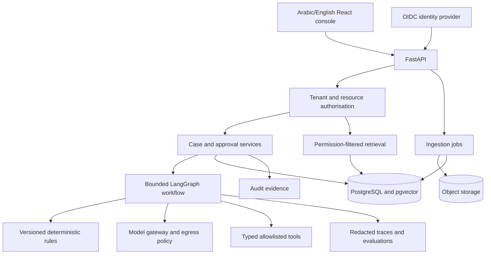

# UAE Sovereign Agentic AI: advanced development specification

Status: proposed design, not an implemented or certified system.

## 1. Product and delivery objective

Build an independent Arabic/English enterprise AI sandbox that helps authorised
users find evidence, process procurement cases, compare quotations, and review
recommendations. Use public or synthetic records for development. No government
affiliation, production access, compliance certification, or deployment is implied.

This specification builds on the supplied End-to-End Roadmap and Complete
Technology Stack PDFs. Their technology catalogue is a reference, not an
instruction to install every product. The initial repository contains a README
only. This document establishes scope; application implementation remains ahead.

The goal is demonstrable engineering quality, not a claim of “100% advanced,”
perfect AI accuracy, or a guaranteed career outcome. Completion means passing
versioned acceptance criteria with recorded evidence.

## 2. Users and first workflow

Roles: requester, procurement analyst, reviewer, tenant administrator and auditor.
Permissions are scoped to tenant, document and action. A platform administrator
does not automatically receive permission to read every tenant's documents.

First workflow:

1. Requester creates a case and supplies an evaluation checklist.
2. Analyst uploads supplier quotations and approved policy documents.
3. Ingestion validates files, extracts text and tables, and preserves provenance.
4. Retrieval finds authorised, applicable evidence.
5. Extraction produces typed fields and evidence locations.
6. Deterministic rules check completeness, dates, currencies and calculations.
7. AI drafts a cited comparison; missing or conflicting evidence remains visible.
8. An authorised reviewer approves, rejects or requests changes.
9. The system records a simulated outcome and produces an evidence report.

Real awards, purchasing, payments, government-system connections and automated
employment decisions are outside the sandbox. Integrations require a separately
defined and authorised deployment scope.

## 3. Architecture

Begin as a modular application with API and ingestion worker processes. Avoid
microservices until independent scaling or ownership justifies them. Keep model
calls outside database transactions; persist workflow state at explicit boundaries.

Baseline: Python 3.12+, FastAPI, Pydantic, SQLAlchemy, Alembic, PostgreSQL/pgvector,
React/TypeScript, Docker Compose and pytest. Add OIDC, object storage, a background
queue and LangGraph as the corresponding vertical slices are implemented.
Pin supported dependency versions during implementation, not speculatively here.

## 4. Capabilities that make the system advanced

| Capability | Required design | Demonstration |
| --- | --- | --- |
| Bilingual evidence | Arabic RTL UI, original text preservation, page/table provenance and language-specific evaluation | Equivalent Arabic and English tasks with reviewed answers |
| Policy-aware RAG | Document ACLs, versions, effective dates, supersession and conflict handling | Historical case uses the applicable policy; conflicting sources trigger review |
| Structured procurement analysis | Decimal arithmetic, explicit currencies, unit/tax handling and source-linked fields | Comparison totals reproduce from supplied data; no invented exchange rates |
| Approval integrity | Approval binds case revision, evidence versions, policy version and proposed action digest | Changing a quotation invalidates the old approval |
| Durable execution | Persisted state, bounded retries, idempotency, cancellation and reconciliation | Worker restart resumes a case without duplicate effects |
| Controlled model access | Provider allowlist, data-classification routing, token/cost limits and fail-closed behaviour | Restricted request cannot silently fall back to an external provider |
| Tenant isolation | API checks, database row policies where appropriate, scoped retrieval, files, caches and tools | Adversarial cross-tenant attempts are denied and recorded |
| Evidence lifecycle | Retention, deletion and re-indexing cover originals, chunks, vectors and derived artifacts | Deleted document stops appearing in retrieval and caches |
| Audit integrity | Append-only application interface plus separately protected integrity evidence | Unauthorised modification is denied or detected |
| Measured quality | Versioned datasets, prompts, models, rules and reproducible release reports | A regression fails the applicable release gate |

MCP is an integration interface, not an authorisation boundary. Each tool still
needs server-side permissions, validation, timeouts and scoped credentials.
Use deterministic services for permissions, arithmetic and approval transitions.

## 5. Sovereignty deployment profiles

Maintain explicit profiles rather than treating every cloud deployment as sovereign:

- **Learning sandbox:** synthetic/public data; approved hosted models permitted.
- **UAE residency constrained:** verify the location and terms for every selected
  service, including inference, embeddings, OCR, telemetry, backups, disaster
  recovery, support access, keys and subprocessors. Region labels alone do not
  establish suitability.
- **Restricted/private inference:** approved self-hosted inference and embeddings,
  controlled artifact import, restricted outbound access and local telemetry.
  Benchmark hardware needs before choosing this profile.

Routing must reject disallowed processing. Fallback models must meet the same
policy. Store provider/model identifiers and policy decisions without leaking raw
sensitive content into traces. Model licences and operational costs require review.
Legal and organisational approval remains specific to the actual deployment.

## 6. State, data and APIs

Case states: draft, submitted, processing, needs_information, awaiting_review,
approved_simulation, rejected, cancelled and failed. Define allowed transitions in
code; an LLM response cannot change state directly. Handle concurrent decisions
with optimistic concurrency and idempotent decision requests.

Core entities: Tenant, Membership, Role, Document, DocumentVersion, DocumentACL,
Chunk, Supplier, Case, CaseRevision, Evidence, Extraction, PolicyVersion,
WorkflowRun, ToolInvocation, Approval, AuditEvent and EvaluationRun.

Every resource has a tenant association. Authorisation derives tenant membership
from verified identity, not a client-supplied tenant ID alone. Workers carry an
explicit verified scope. Test database connection-pool scope reset and privileged
database roles; row policies alone do not prove isolation.

Initial API contract:

| Endpoint | Behaviour |
| --- | --- |
| GET /health/live | Process liveness without sensitive details |
| GET /health/ready | Required dependency readiness |
| POST /api/v1/documents | Authorised upload with limits and ingestion status |
| GET /api/v1/documents/{id} | Scoped metadata and version status |
| POST /api/v1/knowledge/query | Cited answer or evidence-based abstention |
| POST /api/v1/cases | Create procurement case |
| POST /api/v1/cases/{id}/runs | Start a bounded workflow idempotently |
| GET /api/v1/cases/{id} | Scoped case, evidence and review state |
| POST /api/v1/approvals/{id}/decisions | Authorised decision against an expected revision |
| GET /api/v1/audit | Permission-controlled audit queries |

Use consistent error schemas, pagination, correlation IDs and generated frontend
types. Do not expose evaluation runners or internal tools as unrestricted APIs.

## 7. Security and reliability requirements

- Verify OIDC token issuer, audience, expiry and signature; deny access by default.
- Enforce document permissions before retrieval and again when resolving citations.
- Treat files, passages and model output as untrusted data. Enforce file limits,
  parser resource limits, safe storage keys and quarantine/scanning policy.
- Require server-side tool permissions; a model-proposed tool call grants no access.
- Enforce separation of duties for workflows that require independent review.
- Use encryption, secret management, redacted logs and scoped object access.
- Never claim exactly-once external execution from a retry mechanism alone; use
  destination idempotency or an outbox and reconciliation strategy.
- Revalidate authorisation, evidence revision and approval when resuming a workflow.
- Record backup retention and deletion exceptions; do not promise immediate physical
  removal from every backup. Test restore and reapply deletion obligations.
- Define outage behaviour for model, parser, database and queue failures. Show
  recoverable status rather than silently presenting incomplete results as complete.

## 8. Data and documentation to prepare

Initial dataset: 30 synthetic suppliers, 10 procurement cases, 20 quotations and
10 approved public/synthetic policy documents. Include Arabic/English material,
scanned pages, tables, expired records, conflicting policies and missing fields.
Record source, permission, version, language, classification and expected outputs.
Expand coverage before interpreting benchmark scores as representative.

Prepare these artifacts incrementally:

1. Product brief, user stories, exclusions and acceptance criteria.
2. Procurement workflow, approval matrix and exception paths.
3. Data inventory, permissions, retention and residency matrix.
4. Architecture, data-flow diagram and technology decision records.
5. Threat model, misuse cases and security test matrix.
6. Database schema, API contract and tool/agent contracts.
7. Evaluation dataset guide, annotation rubric and benchmark report.
8. Model/provider suitability record and prompt/rule version register.
9. Deployment, migration, backup, restore and incident runbooks.
10. Cost model, user guide and known-limitations report.

## 9. Phased implementation backlog

All stages below are pending implementation. Time estimates require the
developer's experience, weekly availability, budget and deployment profile.

| Stage | Deliverable | Exit gate |
| --- | --- | --- |
| 1. Foundation | API, web shell, configuration, Postgres migrations, Compose and CI | Clean setup runs; meaningful API/database smoke tests pass |
| 2. Identity | OIDC, membership, resource permissions and audit | Cross-tenant, privilege and expired-session tests pass |
| 3. Evidence | Upload, parsing, provenance, retrieval and cited answers | Gold-set baseline recorded; citations resolve only with permission |
| 4. Procurement | Cases, extraction, comparison rules and reviewer UI | Happy path, missing data, rejection and revision tests pass |
| 5. Orchestration | Checkpoints, tools, bounded execution and approval resume | Restart, cancellation, stale approval and duplicate-request tests pass |
| 6. Quality | Arabic/English evaluation, adversarial tests and monitoring | Versioned quality gates pass; failures are triaged |
| 7. Operations | Chosen cloud profile, IaC, secrets, backups and rollback | Deployment, restore and rollback demonstrated |
| 8. Extensions | HR knowledge, service desk and optional demand forecast | Each extension passes its own permissions and quality gates |

Start with Stage 1, then deliver one procurement case end to end. Add extensions
only after the shared evidence, permissions and approval services work.

## 10. Proposed release gates, not measured results

Start with at least 100 reviewed questions, split between Arabic and English, plus
separate workflow and adversarial cases. Preserve a held-out set and document
annotation quality. Report per-language, per-document-type and per-field results;
do not hide weak Arabic performance inside an aggregate score.

Initial candidate targets: retrieval recall@5 >= 85%, citation precision >= 95%,
and key-field extraction F1 >= 90% on the declared held-out dataset. These are
planning targets to review after the baseline, not current performance claims.
Evaluate answer correctness and abstention separately, with human-reviewed examples.

Require all mandatory authorisation, approval-integrity and tenant-isolation tests
to pass. No unresolved critical security finding may pass the release gate. A
passing finite test suite does not prove the absence of security vulnerabilities.

Record latency, throughput, cost per successful case and failure rates before
setting service-level targets. Include hardware, model, dataset and concurrency.
Require a demonstrated restore, rollback and documented operator recovery path.
Treat completion percentage as accepted backlog items divided by agreed scope;
it is not a universal score for technological advancement.

## 11. Technologies to defer

Defer Kubernetes, service meshes, distributed streaming, several vector databases,
multiple agent frameworks, fine-tuning and multi-region failover until a measured
requirement justifies their operational cost. A local model is an optional
deployment choice with hardware and quality trade-offs, not an automatic upgrade.
Forecasting must beat an appropriate baseline on held-out temporal data before it
is presented as a useful capability.

## 12. Immediate implementation increment

Implement a small foundation: FastAPI health endpoints, typed configuration,
PostgreSQL migration, a synthetic procurement-case API, React case list and CI.
Verify case persistence and invalid input handling. Introduce identity before any
multi-user or non-local exposure; do not label a local scaffold production-ready.
Then add evidence ingestion, permission-filtered retrieval and the reviewer flow.
