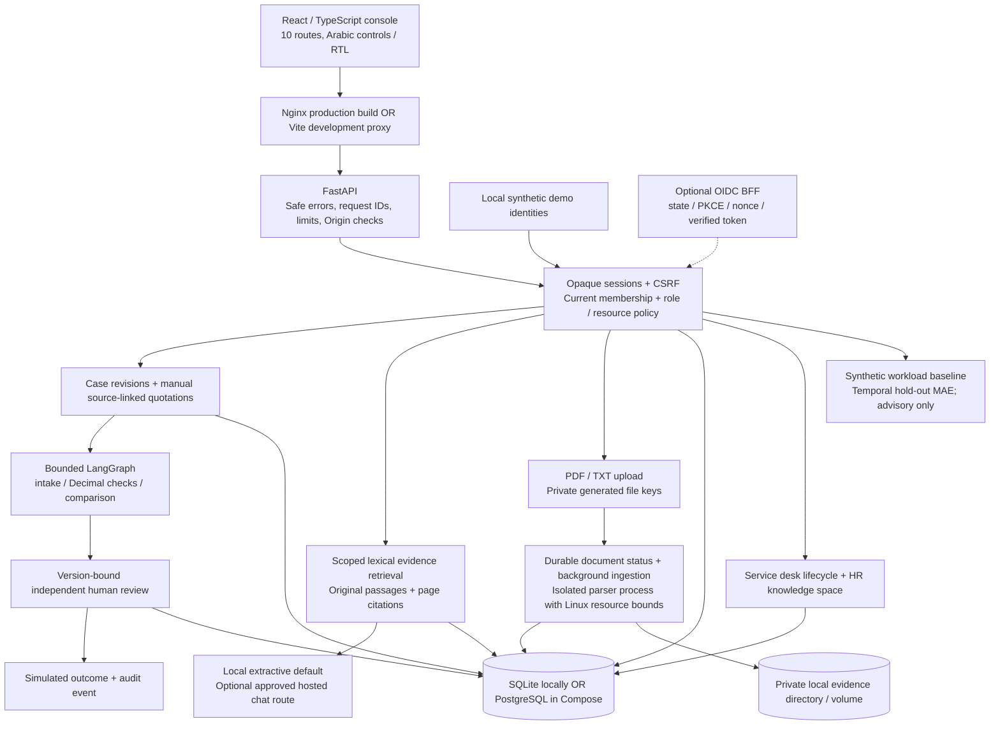

# Architecture implemented by this source release

The earlier six-view PDF describes the full target. This diagram shows the actual
runnable reference, with external integrations explicitly distinguished.

Jobs claim queued documents atomically. Parser results cannot overwrite a deleted
document; stale review snapshots cannot produce approval. Graph steps/results are
stored in the application database. Deterministic graph replay is not claimed as
distributed exactly-once orchestration. The app has no real purchasing effects.

Core source boundaries: `core/` configuration/security/migration; `db.py` models;
`domain/` request schemas; `rag/` parser and retrieval; `graphs/` comparison;
`api/` authenticated routes; `ml/` baseline; `worker.py` ingestion; frontend
`ui.tsx` primitives, `pages.tsx` console routes and `workflows.tsx` business dialogs.
